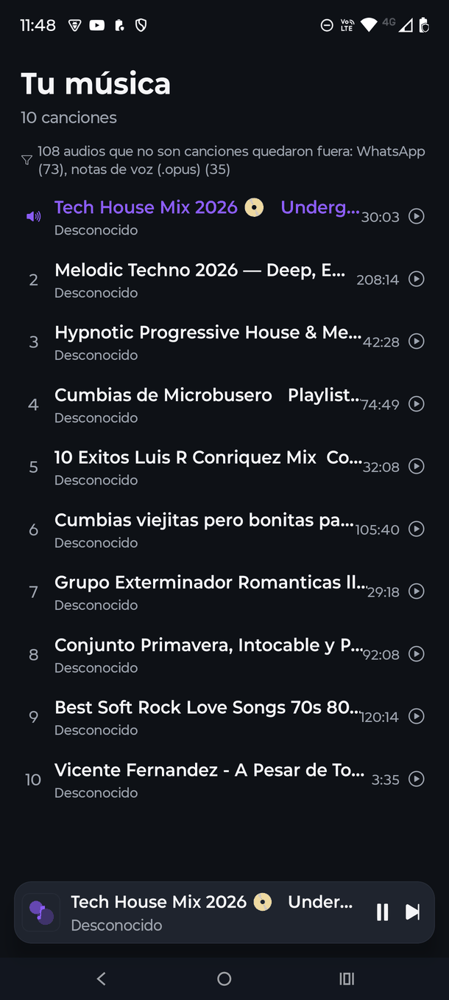
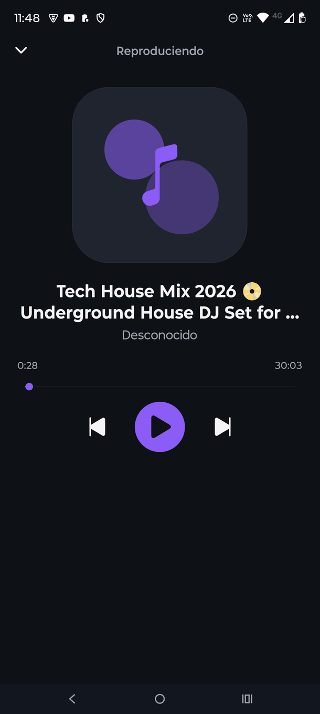

<p align="center">
  
</p>

<h1 align="center">Reproductor</h1>

<p align="center">
  Reproductor de música para Android construido con React Native y Expo.<br/>
  Lee el audio del dispositivo y lo reproduce en primer y segundo plano.
</p>

<p align="center">
  
  
  
  
</p>

<p align="center">
  
  
</p>

---

## Características

- **Solo canciones de verdad**: la biblioteca descarta notas de voz, grabaciones y el audio de otras apps (WhatsApp, Telegram, grabadoras…). La app **solo lista música**.
- **Biblioteca del dispositivo**: lista hasta 1000 canciones ordenadas por fecha de creación.
- **Aviso de filtrado**: bajo el título se indica cuántos audios se quedaron fuera y por qué (p. ej. *"108 audios que no son canciones quedaron fuera: WhatsApp (73), notas de voz (.opus) (35)"*).
- **Reproductor a pantalla completa**: portada, título, artista, barra de progreso con *seek* y controles anterior / play / siguiente.
- **Mini reproductor flotante**: siempre visible sobre la lista, con play-pausa y salto, y por encima de la barra de navegación del sistema.
- **Reproducción en segundo plano verificada**: la música sigue sonando con la app cerrada, supera el límite de ~3 minutos de Android y avanza de canción automáticamente.
- **Controles en la barra de notificaciones y pantalla de bloqueo** con metadatos reales de la canción en reproducción.
- **Cola de producción global**: los controles funcionan desde cualquier pantalla.
- **Tema oscuro propio**, SafeArea (edge-to-edge) e íconos `Ionicons`.
- Estados de carga, sin permiso, sin canciones y de error.

## El filtro de canciones

`expo-media-library` **no expone** la columna `IS_MUSIC` de MediaStore (ni álbum ni artista), así que no
existe una forma "nativa" de saber si un archivo es música. El filtro se hace en JavaScript con las tres
señales que sí llegan al app:

| Señal | Regla | Ejemplo |
| --- | --- | --- |
| **Extensión** | `.opus`, `.amr`, `.awb`, `.oga` son formatos de nota de voz / grabación | `PTT-20261021-WA0001.opus` |
| **Ruta** | Todo lo que esté bajo `Android/media/<paquete>/` queda fuera, salvo las apps de streaming musical (allowlist) | `Android/media/com.whatsapp/…` |
| **Carpeta** | Carpetas de mensajería, redes, grabadoras, pódcast, audiolibros, alarmas y notificaciones | `…/Recordings/`, `…/Podcasts/` |
| **Nombre** | Los patrones de WhatsApp delatan el origen aunque el archivo esté en `/Download` | `PTT-…`, `AUD-…`, `VID-…` |

Todo lo que no se descarta se considera canción. Las reglas viven en un único sitio,
[`src/utils/songFilter.js`](./src/utils/songFilter.js) (listas `VOICE_ONLY_EXTENSIONS`,
`NON_MUSIC_APP_PACKAGES`, `MUSIC_APP_PACKAGES` y `NON_MUSIC_FOLDERS`).

> **¿No aparece tu canción?** Si está guardada dentro de la carpeta de otra app (por ejemplo
> `Android/media/com.whatsapp/Music/`) se filtra aunque sea un `.mp3` de verdad. Muévela a
> `/sdcard/Music/` (o a `Downloads/`) y aparecerá en la lista.

## Descarga rápida

Descarga e instala el APK compilado que está en este mismo repositorio:

👉 **[`reproductor.apk`](./reproductor.apk)** (≈73 MB)

> En la página de GitHub, entra al archivo y pulsa **"Download raw file"**.
> Al instalarlo, Android pedirá permitir instalar de orígenes desconocidos.

También puedes compilar tu propio APK (ver abajo).

## Instalación desde el código

Requisitos: cuenta de [Expo](https://expo.dev/), `adb` y un dispositivo Android conectado por USB.

```sh
git clone <url-del-repositorio>
cd reproductor
npm install

# Compilar APK en la nube (perfil "preview")
npx --yes eas-cli@latest whoami
npx --yes eas-cli@latest build -p android --profile preview \
  --message "primer build" --non-interactive --no-wait

# Ver el estado del build y copiar la URL del APK
npx --yes eas-cli@latest build:view <buildId>

curl -sL "<buildUrl>" -o reproductor.apk

# Instalar en el dispositivo
adb install -r reproductor.apk
adb shell am start -n com.jorgefrancisco.reproductor/.MainActivity
```

> **Importante**: la app **no funciona en Expo Go**. En Android, Expo Go ya no permite leer la
> biblioteca multimedia del dispositivo, así que hace falta un build propio (APK o dev build).
> Compilar en local no es necesario: todo pasa por EAS Build.
>
> `npx eas` **no** es el CLI de Expo (resuelve un paquete homónimo sin binario): usa
> `npx --yes eas-cli@latest`.
>
> Si `adb install` falla con `INSTALL_FAILED_VERIFICATION_FAILURE`, el móvil tiene activada la
> verificación de Play Protect para apps instaladas por USB. Desactívala con
> `adb shell settings put global verifier_verify_adb_installs 0` y
> `adb shell settings put global package_verifier_enable 0`.

## Desarrollo

```sh
npx expo start                     # Metro / dev server
npx expo export --platform android # Verifica que el bundle compila
```

No hay suite de tests, linter ni comprobación de tipos: que el bundle compile limpio es toda la señal
disponible antes de compilar.

### Verificar en el dispositivo

Como no hay tests, la verificación real se hace sobre el móvil conectado por `adb`:

```sh
# Texto y coordenadas reales de lo que se está viendo
adb shell uiautomator dump /sdcard/ui.xml
adb shell cat /sdcard/ui.xml

# Captura de pantalla
adb exec-out screencap -p > captura.png

# Estado de la reproducción y de la sesión de medios
adb shell dumpsys media_session | grep -i reproductor
adb logcat -d | grep -i reproductor
```

> `uiautomator dump` puede fallar con *"could not get idle state"* si hay algo animándose
> continuamente (el slider del reproductor se actualiza mientras suena): pausa la reproducción y
> vuelve a intentarlo.

## Logotipo

El logotipo **"jfmMusic"** (`jfm` en blanco + `Music` en morado + ecualizador, sobre fondo degradado
violeta/negro) está **generado por código** con Pillow, no dibujado a mano:

```sh
python3 scripts/generate-logo.py
```

Regenera los seis ficheros que usa la app:

| Fichero | Tamaño | Uso |
| --- | --- | --- |
| `assets/icon.png` | 1024 | icono principal (a sangre) |
| `assets/android-icon-background.png` | 512 | fondo del icono adaptativo de Android |
| `assets/android-icon-foreground.png` | 512 | logo con transparencia (primer plano adaptativo) |
| `assets/android-icon-monochrome.png` | 432 | icono monocromo (Android 13+) |
| `assets/favicon.png` | 48 | favicon web |
| `assets/splash-icon.png` | 1024 | logo de la pantalla de inicio |

La paleta sale de [`src/theme/index.js`](./src/theme/index.js) (`primary` `#8B5CF6`, fondo `#0E1116`).

## Stack

| Componente | Detalle |
| --- | --- |
| Framework | Expo SDK `~57.0.11` (plantilla `create-expo-app` blank) |
| Runtime | React Native `0.86.2`, React `19.2.3` |
| Audio | `expo-audio` — reproducción, lock screen y servicio de medios |
| Biblioteca | `expo-media-library` (API legacy) — `READ_MEDIA_AUDIO` |
| UI | `@react-native-community/slider`, `@expo/vector-icons`, `react-native-safe-area-context` |
| Builds | EAS Build (`development` / `preview` / `production`) |
| Iconos | Pillow (`scripts/generate-logo.py`) |

## Estructura

```
App.js                        Navegación simple (biblioteca ↔ reproductor)
src/
  context/PlayerContext.js    Reproductor global, cola, controles y permisos
  hooks/useSongs.js           Carga de canciones del dispositivo + resumen de descartes
  screens/
    LibraryScreen.js          Lista de canciones + nota de filtrado + banner de notificaciones
    PlayerScreen.js           Reproductor a pantalla completa
  components/
    AlbumArt.js               Portada (placeholder)
    MiniPlayer.js             Barra flotante con la canción actual
    PlayerControls.js         Botones anterior / play / siguiente
  theme/index.js              Colores, espacios, radios y tipografías
  utils/
    format.js                 formatTime, titleFromFilename
    songFilter.js             Reglas que deciden qué audios son canciones
    env.js                    Detección de Expo Go
scripts/
  generate-logo.py            Genera los iconos de la app (Pillow)
docs/                         Capturas de pantalla para el README
```

## Limitaciones conocidas

- Los **metadatos reales (ID3/MediaStore) todavía no se leen**: el artista aparece como "Desconocido" y la portada es un placeholder generado.
- Las canciones que siguen guardadas dentro de la carpeta de otra app (WhatsApp, Telegram…) **no se listan**, aunque sean `.mp3` de música real: hay que moverlas a `/sdcard/Music/`.
- Sin búsqueda, orden por artista/álbum, modo shuffle, repetición ni playlists.
- Sin gestión de archivos (borrar, renombrar o importar canciones).
- `versionCode` de `app.json` se ignora: la versión la controla EAS (`appVersionSource: "remote"`).

## Próximos pasos

1. Leer tags reales (artista, álbum, carátula) desde MediaStore y mostrar la portada real, incluida en la notificación y la pantalla de bloqueo.
2. Mantener la metadata de la notificación actualizada al cambiar de canción automáticamente.
3. Búsqueda, orden, shuffle/repetición y favoritos con persistencia local.

El detalle completo y el estado actual del proyecto están en [`ESTADO.md`](./ESTADO.md), y las
trampas del framework que conviene conocer antes de tocar el código, en [`AGENTS.md`](./AGENTS.md).

## Licencia

[MIT](./LICENSE) — licencia incluida en la plantilla de Expo sobre la que se creó el proyecto.
